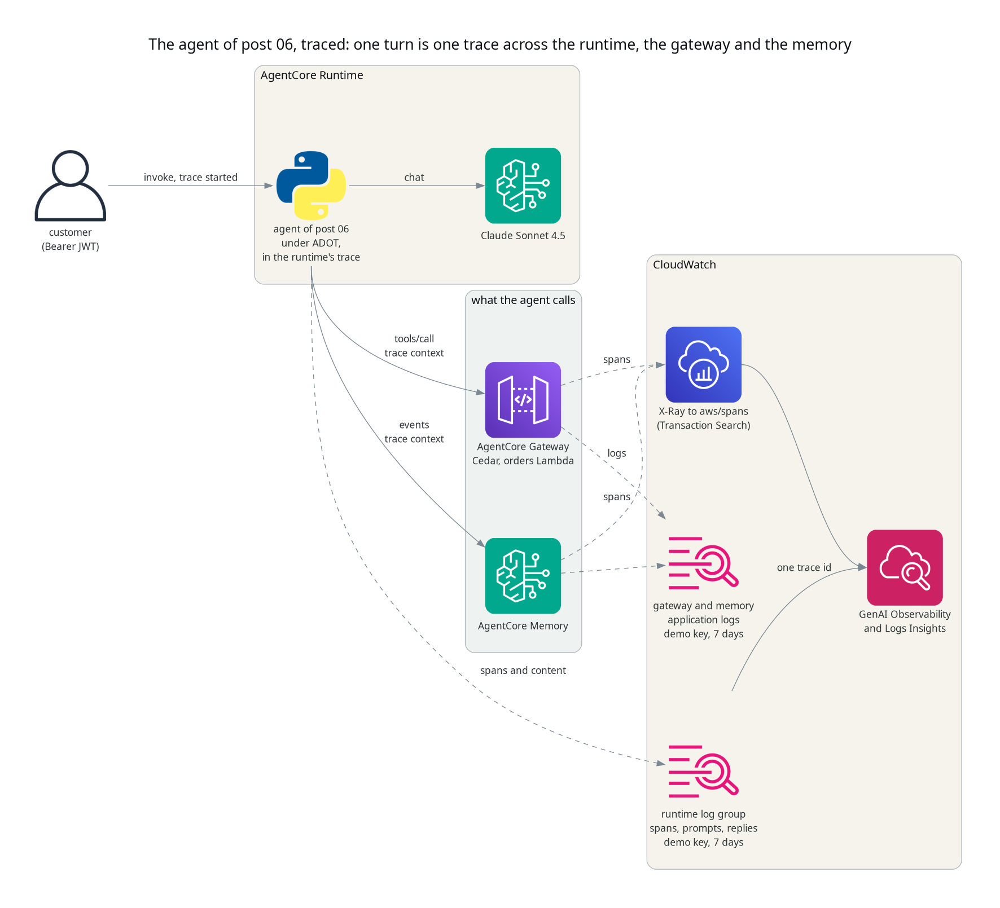
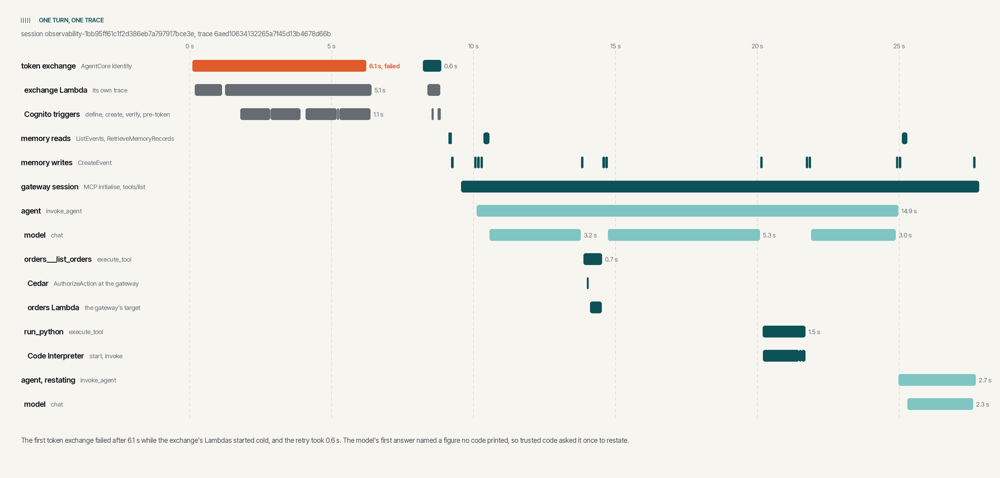

# Tracing an AgentCore agent, one turn at a time

## TL;DR;

The order support agent from post 06 now sends OpenTelemetry traces to
CloudWatch. One customer's turn becomes one trace. It covers the runtime,
every model call, the gateway's Cedar check and the orders Lambda, the
sandbox and the memory, and every span the agent starts carries the
conversation's session id. The change to the agent is a package, a start command and about twenty
lines of Python, plus log deliveries for the gateway and the memory. On the
first live run the trace showed two things the response never could, a
token exchange that failed on a cold start and was retried, and a figure
the model stated without having computed it.

> SOURCE CODE - All code for this post is available at:
> https://github.com/levantar-ai/demos/tree/main/agentcore/07-observability

## Longer version

This series is building one thing, the order support agent for Brightwell,
a small online retailer of outdoor kit that ships with DPD and Royal Mail.
Post 06 handed a Bedrock model the gateway, the Code Interpreter sandbox
and AgentCore Memory, and let it decide what to call. Each response carries
a trail of the tools the model chose, which tells the caller what happened
in that one turn.

An operator needs more than that. They need every turn, for every
customer, with how long each step took, what the model was sent and what
it said back, and any errors along the way. That is what AgentCore
Observability gives you. The runtime starts a trace for every request,
the agent's spans and the gateway's and the memory's join it, and
CloudWatch shows them as one trace per request.

Nothing the agent does changes in this post. The model, the tools, the
identity chain and the Cedar policy are post 06's.



## 1 - Sending the spans

AgentCore Runtime injects the OpenTelemetry settings into the container as
environment variables. What reads them is the AWS Distro for OpenTelemetry
(ADOT), and a container runs whatever command its image names, so the image
installs ADOT and starts the agent under it. Two lines of the Dockerfile
change:

```dockerfile
RUN pip install --no-cache-dir boto3==1.43.108 strands-agents==1.57.2 bedrock-agentcore==1.24.0 aws-opentelemetry-distro==0.22.0

CMD ["opentelemetry-instrument", "python", "main.py"]
```

`opentelemetry-instrument` sets up the exporters before `main.py` imports
anything. From then on Strands Agents emits a span for the agent, each
event loop cycle, each model call and each tool, and the botocore and MCP
instrumentation emit one for every AWS call and MCP request the agent
makes.

The runtime role already had `xray:PutTraceSegments` and
`cloudwatch:PutMetricData` from post 01. It gains the rest of what the
AgentCore runtime permissions page lists for observability, scoped to this
runtime's own log groups where IAM allows it:

```json
{
  "Sid": "LogsForTraces",
  "Effect": "Allow",
  "Action": ["logs:DescribeLogStreams", "logs:PutResourcePolicy"],
  "Resource": "arn:aws:logs:us-east-1:111122223333:log-group:/aws/bedrock-agentcore/runtimes/demos_agentcore_07_observability-*"
},
{
  "Sid": "Tracing",
  "Effect": "Allow",
  "Action": ["xray:PutTraceSegments", "xray:PutTelemetryRecords", "xray:GetSamplingRules", "xray:GetSamplingTargets"],
  "Resource": "*"
}
```

`logs:DescribeLogGroups` is granted on `*`. That page lists it on
`log-group:*`, but the action cannot be scoped to log groups and the IAM
policy simulator denies it written that way. It lists log group names and
settings, never their contents.

NOTE: spans only reach CloudWatch once CloudWatch Transaction Search is
enabled. It is a setting for the whole account and Region rather than for
one agent, so it is not part of this demo's Terraform. The demo's README
has the three commands that enable it, and
`aws xray get-trace-segment-destination` shows `CloudWatchLogs` and
`ACTIVE` when it is on.

## 2 - Keeping the turn in the runtime's trace

The runtime starts a trace for every request and passes its context to
the container in the request headers. ADOT picks those headers up for the
web frameworks it instruments. This agent's server is the standard
library's `http.server`, which ADOT does not instrument, so nothing reads
them. Left alone, every span of the turn would start a trace of its own,
cut off from the runtime's invocation.

So the handler reads them itself, before the turn runs:

```python
@contextmanager
def traced(headers, session):
    ctx = propagate.extract(headers)
    if baggage.get_baggage("session.id", ctx) != session:
        ctx = baggage.set_baggage("session.id", session, ctx)
    token = context.attach(ctx)
    try:
        yield
    finally:
        context.detach(token)
```

```python
with traced(self.headers, session), one_turn(subject, session):
    gateway_token = self.exchange(bearer_from(self.headers))
    turn = self.respond(prompt, customer, session, gateway_token, subject)
```

`propagate.extract` uses the propagators ADOT configured, W3C baggage,
X-Ray and W3C trace context, so every span the turn starts becomes a child
of the runtime's. The session id goes into the baggage, and ADOT's span
processor copies `session.id` from the baggage onto every span the agent
starts inside the block. That one attribute is what lets CloudWatch group
a conversation's turns, and what lets you query them.

The botocore and MCP spans carry the trace context out of the container.
The gateway and the memory receive it with each call, so their own spans
land in the same trace. The memory's spans carry the session id too, as
the memory's own session. The gateway's and the orders Lambda's are tied
to the turn by the trace id alone.

## 3 - The gateway and the memory

The runtime sends its logs and spans to CloudWatch on its own. The gateway
and the memory leave their destinations to you, so each one gets two
CloudWatch Logs deliveries, its application logs to a log group and its
spans to X-Ray:

```hcl
resource "aws_cloudwatch_log_delivery_source" "traces" {
  for_each     = local.observed # the gateway and the memory
  name         = "${local.name_prefix}-${each.key}-traces"
  log_type     = "TRACES"
  resource_arn = each.value
}

resource "aws_cloudwatch_log_delivery_destination" "traces" {
  name                      = "${local.name_prefix}-traces"
  delivery_destination_type = "XRAY"
}

resource "aws_cloudwatch_log_delivery" "traces" {
  for_each                 = local.observed
  delivery_source_name     = aws_cloudwatch_log_delivery_source.traces[each.key].name
  delivery_destination_arn = aws_cloudwatch_log_delivery_destination.traces.arn
}
```

The `APPLICATION_LOGS` deliveries have the same shape, with a log group as
the destination. Transaction Search writes the X-Ray spans to the
`aws/spans` log group, where the gateway shows up as inbound
authorisation, the Cedar `AuthorizeAction`, the tool invocation and the
orders Lambda behind it, and the memory as each `ListEvents`,
`CreateEvent` and `RetrieveMemoryRecords`.

## 4 - One turn, one trace

The customer asked the same question as in post 06, how much they had
spent this year by month and which month was the biggest. The agent's
answer was right. Here is the trace of that turn, drawn from the spans
CloudWatch stored for it.



Read from the top, the turn did this.

- It exchanged the customer's token for a gateway token through AgentCore
  Identity. The first attempt failed after 6.1 s, and the retry succeeded
  in 0.6 s. More on that below.
- It read the conversation and the customer's remembered preferences from
  memory, and opened an MCP session with the gateway.
- The model asked for `orders___list_orders`. The gateway checked the
  token, Cedar allowed the call, and the orders Lambda answered. The Cedar
  span records the decision, `ALLOW`, and the policy that decided it,
  `demos_agentcore_07_own_orders_only`.
- The model wrote pandas and asked for `run_python`. The sandbox started
  and ran it.
- The model answered, and then the agent ran again with one more model
  call, restating that answer.
- Memory recorded each step as an event as it went.

## 5 - Finding a turn by its session

Every span the agent starts carries `session.id`, so a conversation can be
pulled out of the runtime's log group with Logs Insights. This shows how many model calls
each turn made and the tokens they used:

```
filter @logStream = "spans" and name = "chat"
  and `attributes.session.id` = "observability-1bb95ff61c1f2d386eb7a797917bce3e"
| stats min(startTimeUnixNano) as started, count(*) as model_calls,
        sum(`attributes.gen_ai.usage.input_tokens`) as input_tokens,
        sum(`attributes.gen_ai.usage.output_tokens`) as output_tokens
  by traceId
| sort started
```

```
traceId                           model_calls  input_tokens  output_tokens
6aed10634132265a7f45d13b4678d66b  4            8960          644
6aed108000cd74fb1039183c788fa4db  2            5966          284
```

The first turn, the spending question, made four model calls. The second,
which carrier delivered most of the orders, made two. And this finds every
span that failed, across every session:

```
filter @logStream = "spans" and status.code = "ERROR"
| fields @timestamp, name, round(durationNano / 1000000) as ms, status.message
| sort @timestamp
```

```
2026-11-05 23:25:30.206  Bedrock AgentCore.GetResourceOauth2Token  6123
  ValidationException: ... GetResourceOauth2Token operation: HTTP request failed against Token endpoint
```

The CloudWatch console shows the same data as a session list, a trace
timeline and each span's attributes, under GenAI Observability, AgentCore.

## 6 - What the trace showed

Both turns came back with a 200 and a correct answer. The trace shows two
things the response did not.

The first is the failed token exchange. AgentCore Identity calls the
exchange post 05 built, an API Gateway and Lambda in front of a Cognito
pool. On the first request after a deploy, that Lambda and the four
Cognito triggers it sets off all started cold, one after another. The
same happened on a later run after the stack had sat idle for about 25
minutes, so it is any cold start, not only the first. The
exchange took 5.1 s, Identity gave up waiting with `HTTP request failed
against Token endpoint`, and the agent's single retry found everything
warm. That retry went in during post 06 for exactly this case. The trace is
what shows the six seconds the customer waited for it. Those Lambdas run
in traces of their own, because AgentCore Identity calls the exchange
without passing on the trace context, so their spans sit beside this
trace in `aws/spans` rather than inside it.

The second is the extra model call. The first answer ended "In total,
you've spent £743.80 with us this year across 7 orders." The model's code
printed the monthly totals, the biggest month and the year's total, but
never a count. The model had counted the orders itself. The figure check
post 06 added found 7 in no tool result and asked the model once to
restate, which it did without the count. ADOT records the model's input
and output on the turn's log records, so the original answer, the code
the model wrote and the restate request can all be read against the
`chat` spans they belong to. The restatement cost one model call and
2,740 input tokens.

## 7 - The trace is customer data

What makes a trace useful here is that it records the model's input and
output. That means the system prompt, the customer's question, every tool
result including the customer's orders, and every answer. Treat the logs
that hold it as you would the order data itself.

The gateway's and the memory's log groups are this demo's own, encrypted
with the demo's KMS key and kept for seven days. The runtime's group is
created by the service when the runtime is, named after the runtime's id,
with no expiry and no customer-managed key. Terraform cannot create it
first, so it sets both once the runtime exists:

```hcl
resource "null_resource" "runtime_log_group" {
  triggers = {
    log_group = local.runtime_log_group
    key       = aws_kms_key.demo.arn
  }
  provisioner "local-exec" {
    interpreter = ["bash", "-c"]
    command     = <<-EOT
      set -euo pipefail
      aws logs put-retention-policy --region ${var.aws_region} \
        --log-group-name "${local.runtime_log_group}" --retention-in-days 7
      aws logs associate-kms-key --region ${var.aws_region} \
        --log-group-name "${local.runtime_log_group}" --kms-key-id "${aws_kms_key.demo.arn}"
    EOT
  }
}
```

The gateway's, the memory's and the orders Lambda's spans are a different
case. Transaction Search writes them to `aws/spans`, which belongs to the
account rather than to this demo. In this account it keeps them for 30
days with no customer-managed key, and this demo does not change that.
They hold attributes, the tool name, the Cedar decision, the memory's
actor and session ids, rather than the requests and responses, which are
in the application logs above. Whoever owns the account decides the
retention, key and access for `aws/spans`.

Anyone who can read the runtime's log group can read what customers asked
and what they were told, so read access to it should be granted as
narrowly as access to the orders.

The NCSC's guidance on managing the cyber risk of agentic AI asks for the
same trade. It wants the agent's transcripts and reasoning traces
collected, and agent activity treated as a form of user activity, while
warning that those logs "may contain sensitive data" and should be
protected from modification or deletion. For a customer assistant that
sensitive data is personal data, the customer's questions and their order
history, copied word for word into `otel-rt-logs`. What this demo does
about it

- keeps the content only in log groups under the demo's key, for seven
  days, long enough to debug a turn and no longer
- lets the runtime's role write its own logs but not read them, delete them
  or change their retention, so an agent talked into misbehaving cannot
  tidy up after itself
- leaves Strands' redaction available, which drops the conversation from
  the spans where a trace without it is enough

It leaves three things to whoever runs it for real. It creates no access
for people to read the logs, so the narrow grant above is the account
owner's to make. The logs are not immutable, which the NCSC recommends
where possible. A continuous export to an S3 bucket with Object Lock gives
an archive that cannot be altered, though the log group itself can still
be changed by anyone with the rights to. And CloudWatch Logs' data
protection policies mask personal data such as email addresses when the
logs are read or queried, but the original stays stored for anyone granted
`logs:Unmask`. Keeping it out altogether means redacting before the spans
leave the container.

## Conclusion

Tracing an AgentCore agent takes very little. The container starts under
ADOT, the handler joins the trace the runtime started, and the gateway and
the memory are given somewhere to send their spans. After that, one
customer's turn is one trace, from the runtime through the model calls,
the gateway's Cedar check and the orders Lambda, to the sandbox and the
memory, and the agent's spans carry the session id.

It is worth having before anything goes wrong. On its first run it showed
a cold-start failure that a retry was hiding, and the model counting in
its head where the agent's rules say it must compute. Neither was visible
in a response that was right.

References:

- https://github.com/levantar-ai/demos/tree/main/agentcore/07-observability
- https://docs.aws.amazon.com/bedrock-agentcore/latest/devguide/observability.html
- https://docs.aws.amazon.com/bedrock-agentcore/latest/devguide/observability-configure.html
- https://docs.aws.amazon.com/bedrock-agentcore/latest/devguide/runtime-permissions.html
- https://docs.aws.amazon.com/AmazonCloudWatch/latest/monitoring/Enable-TransactionSearch.html
- https://aws-otel.github.io/docs/getting-started/python-sdk
- https://strandsagents.com/latest/documentation/docs/user-guide/observability-evaluation/traces/
- https://github.com/awslabs/amazon-bedrock-agentcore-samples
- https://www.ncsc.gov.uk/blogs/managing-the-cyber-risk-of-agentic-ai
