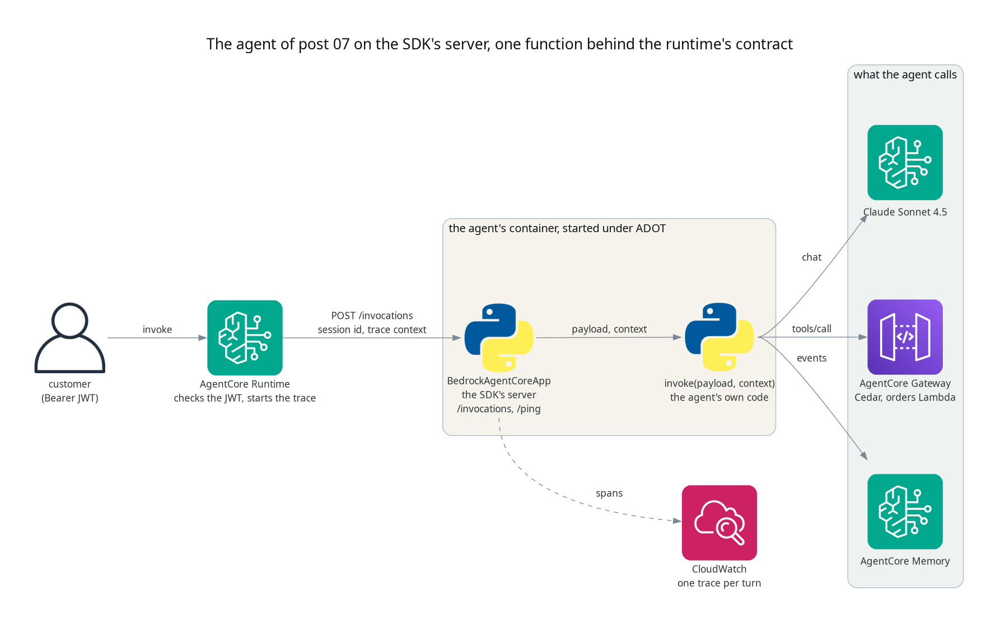

# Moving an AgentCore agent onto the SDK's server

## TL;DR;

The order support agent from post 07 now serves its requests with
`BedrockAgentCoreApp`, the server in AWS's `bedrock-agentcore` Python SDK,
in place of the hand-written one the series has carried since post 01. The
agent becomes one function, the SDK serves the runtime's contract around
it, and the tracing code post 07 added is deleted, because a turn now joins
the runtime's trace without it. The SDK adds no bounds of its own to a
request, and it logs and returns the message of any exception it is handed,
so that part stays in the agent.

> SOURCE CODE - All code for this post is available at:
> https://github.com/levantar-ai/demos/tree/main/agentcore/08-runtime-app

## Longer version

This series is building one thing, the order support agent for Brightwell,
a small online retailer of outdoor kit. Post 01 wrote the agent's HTTP
server by hand on Python's standard library, to show how little AgentCore
Runtime asks of a container, which by default is `POST /invocations` and
`GET /ping` on port 8080. Seven posts later that server is still there, and post 07 had
to add tracing code to it that a web framework would have made unnecessary.

AWS ships a server for this contract in the `bedrock-agentcore` SDK,
`BedrockAgentCoreApp`. It is where the SDK's own quick start begins, so
expect to meet it in other people's agents. This post moves the agent onto
it and the rest of the series builds on that. What the agent does for a
customer does not change, and the infrastructure is post 07's.



## 1 - The agent as one function

The SDK has been in the image since post 06, where the agent took its
memory session manager from it, and Starlette and uvicorn came with it. The
image now pins those two as well, since they serve the agent. The server is
one import, and the function that handles a turn is registered with a
decorator:

```python
from bedrock_agentcore.runtime import BedrockAgentCoreApp

app = BedrockAgentCoreApp(middleware=[Middleware(Admitted)])


@app.entrypoint
def invoke(payload, context):
    headers = context.request_headers or {}
    customer = customer_from(headers)
    subject = subject_from(headers)
    if customer is None or subject is None:
        return refused(401, "no verified caller")
    ...
    session = session_from(context.session_id, payload)
    ...
    with one_turn(subject, session):
        gateway_token = exchange(bearer_from(headers))
        turn = respond(prompt, customer, session, gateway_token, subject)
    return bounded(turn)


if __name__ == "__main__":
    app.run(host="0.0.0.0")
```

The SDK parses the JSON body and passes it in as `payload`. `context` holds
what the runtime sent with the request, the session id from the runtime's
session header and the headers the runtime is configured to forward, which
for this agent is `Authorization`, as post 05 set up. The function returns
a dict and the SDK sends it as JSON, or it returns a Starlette response
when it wants a status code of its own, which is how the refusals are sent.
AgentCore Runtime reports any error status from the container to its own
caller as a 424, so those codes are read in the logs and the trace.

> NOTE: the second parameter has to be called `context`. The SDK looks for
> that name to decide whether to pass the context at all.

The SDK also answers `/ping`, and it runs the function on a worker thread,
so a turn waiting on the model does not stop the health check being
answered.

What is deleted is everything that was only there to be a server, the
routing, reading and parsing the body, and writing each response.

> NOTE: `app.run()` listens on localhost unless it finds Docker's
> `/.dockerenv` file or a `DOCKER_CONTAINER` environment variable. The
> runtime has to reach the port, so name the host as above rather than
> leave it to the detection.

## 2 - The trace joins itself

Post 07 added a function, `traced()`, that read the trace context from the
request headers, put the session id in the baggage and attached both for
the length of the turn. It was needed
because ADOT, the AWS Distro for OpenTelemetry, instruments web frameworks
and the standard library's server is not one.

`BedrockAgentCoreApp` is a Starlette application, and Starlette is one of
the frameworks ADOT instruments. So `traced()` is deleted and nothing
replaces it. The start command from post 07 is what makes that work, and it
has not changed either:

```dockerfile
CMD ["opentelemetry-instrument", "python", "main.py"]
```

`opentelemetry-instrument` loads ADOT before any of the agent's code is
imported, so the SDK's app is built on a Starlette that is already
instrumented. ADOT's middleware reads the runtime's headers and starts a
span for the request, and the SDK carries that context onto the worker
thread the function runs on.

The session id needs no code either. On this deployment the runtime sends
it in each request's baggage, which is not something AWS documents, and
ADOT copies it from there onto every span. The query in section 4 is how to
check it.

## 3 - What stays in the agent

The SDK passes the payload to the function unchanged, and the decorator's
own documentation says to validate it. The caller check, the prompt check and
the session check are the same lines as before.

The hand-written server also bounded what it would take on. The SDK adds
no bounds of its own below the runtime's, which allow a 100 MB payload. It
reads whatever body it is sent, waits as long as the body takes to arrive
and has no limit on the turns in flight. The
app's constructor accepts ASGI middleware, so the agent's bounds, a 2 MB
body that arrives within 30 seconds and eight turns at once, are applied
before the SDK reads anything:

```python
class Admitted:
    def __init__(self, app):
        self.app = app

    async def __call__(self, scope, receive, send):
        if scope["type"] != "http" or scope["method"] != "POST":
            return await self.app(scope, receive, send)
        headers = dict(scope["headers"])
        length = headers.get(b"content-length", b"")
        if b"transfer-encoding" in headers or not length.isdigit() or not 0 < int(length) <= MAX_BODY_BYTES:
            return await refused(413, "request body must be 1..2MB")(scope, receive, send)
        if not _turns_in_flight.acquire(blocking=False):
            busy = f"the agent is serving {MAX_TURNS_IN_FLIGHT} turns already; try again"
            return await refused(503, busy)(scope, receive, send)
        try:
            await self.app(scope, timely(receive), send)
        finally:
            _turns_in_flight.release()
```

`timely()` is the 30 seconds, a wrapper that gives up on a body that has
not all arrived by then. The bound on turns is this process's own, and the
runtime gives each session its own microVM, so it limits one session and
not the whole agent.

The other thing that stays is what happens to an exception. One that
escapes the function is logged by the SDK with its traceback and answered
with a 500 whose body is its message, and a message can carry a token, a
response body or the model's code. So the function catches everything,
logs the exception's class and answers with the same generic error as
before:

```python
    except Exception as exc:
        print(f"turn failed for {customer}: {describe(exc)}")
        return refused(502, "request failed")
```

## 4 - The same turn, the same trace

Deployed, the agent answers as it did in post 07. The model lists the
customer's orders through the gateway and works the figures out in the
sandbox, and the response carries the trail and the answer, which ends:

```
  1. orders___list_orders  [success]
  2. run_python  [success]

Your biggest month was February with £310.50, and you've spent £743.80 with us this year in total.
```

The trace is the part worth checking, since the code that joined it is
gone. One Logs Insights query over the runtime's `spans` stream finds the
conversation by its session id and counts the spans of each trace:

```
filter @logStream = "spans" and `attributes.session.id` = "<session id>"
| stats count(*) as spans by traceId
```

```
traceId                           spans
6b015f451fa5d85d54880d7d4466490b     46
6b015f5b17f98a264b2eb19c67e4ca3c     29
6b015f444a7d8c596a6017e17a676515      1
6b015f4301387ac35efa0cfa34dc6593      1
```

The first two are the conversation's two turns, each one trace. A second
query, for spans in those traces without the session id, finds none. The
first span in the container is now the request itself, `POST /invocations`,
and its parent is the runtime's span, so the turn sits under the runtime's
trace as it did before. The gateway's Cedar check, the orders Lambda and
the memory join the same trace, as in post 07.

The last two are requests that were refused with a 400, one by the agent
for a blank prompt and one by the SDK for a body that was not JSON. A
refusal is a trace of one span now, because the span starts before the
agent's function is called.

## Conclusion

Moving onto `BedrockAgentCoreApp` removes the code that was only there to
be a server, and with ADOT it removes the tracing code as well. What it
leaves is what was always the agent's to decide, who the caller is, what a
valid request is, how much the process takes on and what is said when a
turn fails.

The series now runs on the SDK's server, which is where the next post
starts, evaluations as a quality gate.

References:

- https://github.com/levantar-ai/demos/tree/main/agentcore/08-runtime-app
- https://github.com/aws/bedrock-agentcore-sdk-python
- https://docs.aws.amazon.com/bedrock-agentcore/latest/devguide/runtime-http-protocol-contract.html
- https://docs.aws.amazon.com/bedrock-agentcore/latest/devguide/runtime-header-allowlist.html
- https://aws-otel.github.io/docs/getting-started/python-sdk
